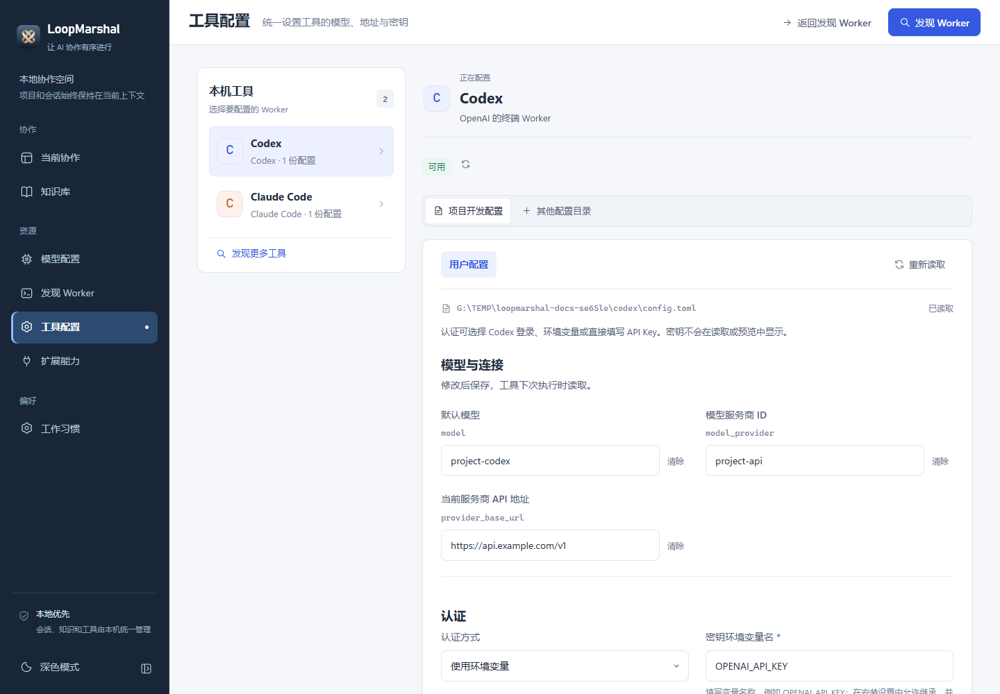
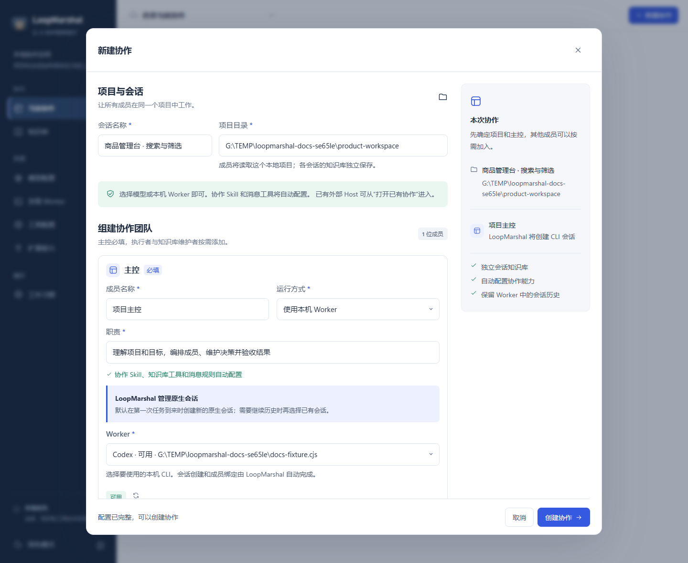
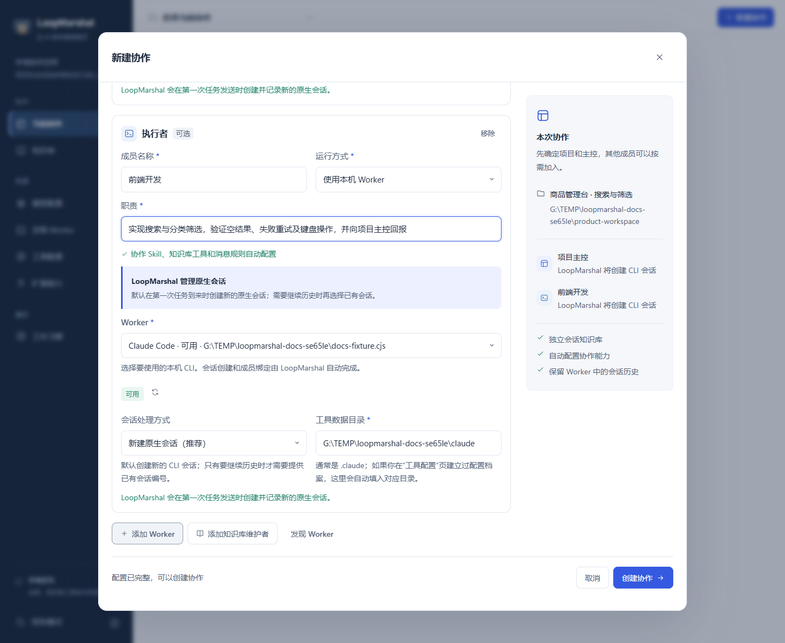
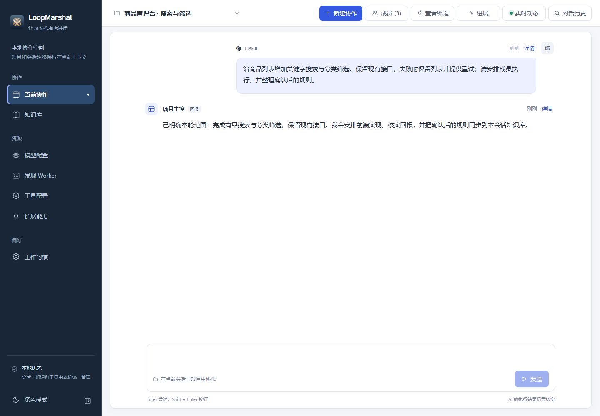
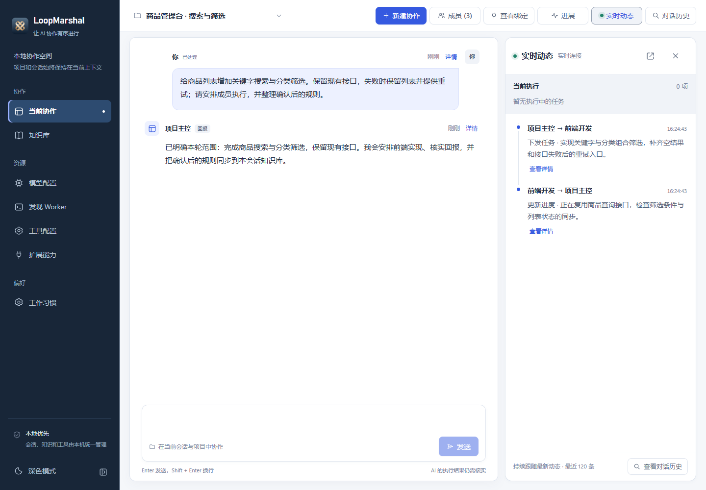
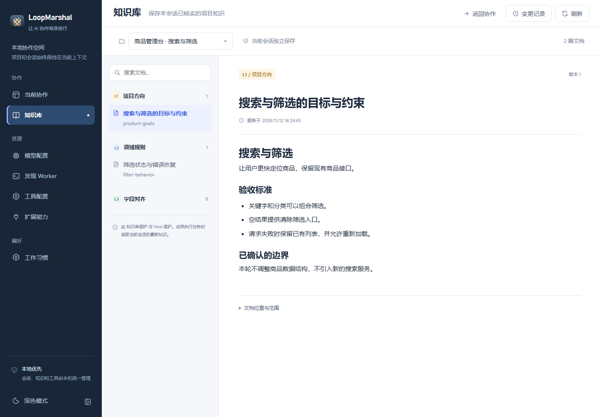

# 创建你的第一个协作会话

适用于 **0.1.0 开发版**。本指南从打开客户端开始，带你配置 Host、加入 Worker、发送任务并检查回报。启动和安装方式见 [README](README.md#1-启动客户端或浏览器工作台)。

## 先选一种开始方式

| 你已经准备了什么                           | 从哪里开始                                            | 新建协作时选择什么                              |
| ------------------------------------------ | ----------------------------------------------------- | ----------------------------------------------- |
| 本机 Codex、Claude Code 等已能正常执行任务 | **发现 Worker** 登记安装，**工具配置** 核对账号与模型 | **使用本机 Worker**                             |
| 有模型服务的 API 地址、模型 ID 和密钥      | **模型配置 → 添加模型**                               | **使用本地模型**                                |
| 外部 IDE/CLI 已通过 LoopMarshal 创建了协作 | 左上角会话名称 → **刷新 / 打开已有协作**              | 直接打开原协作，见[继续已有协作](#继续已有协作) |

第一次使用建议选前两种之一。**不必同时配置两种方式**；一个团队的不同成员也可以分别选择不同方式。“使用本地模型”表示由 LoopMarshal 执行 Agent，模型接口可以在本机或远程，并不限定离线模型。

本指南示例：在已有项目 `D:\Projects\shop-admin` 中，由 `项目主控` 安排 `前端开发` 完成搜索功能，按需加入 `知识库维护`。请替换成你自己真实存在的项目目录和工具配置，不要照抄截图中的临时路径或演示 API 地址。

## 第一步：准备一个可用的执行方式

### 方式 A：使用本机 Codex、Claude Code 等工具

1. 打开左侧 **发现 Worker**，点击页面内的 **发现 Worker** 开始扫描。
2. 找到要使用的工具，点击该项的 **添加工具**。如果没扫到，使用手动 **添加工具**，选择工具类型，并填它的**可执行文件完整路径**。
3. 打开左侧 **工具配置**，选择刚登记的工具。确认页面读取的是这个工具真正使用的配置目录。
4. 核对 **模型、Base URL 和认证信息**。Codex 可以选择 **沿用 Codex 登录 / 使用环境变量 / 直接填写 API Key**；其他工具按页面实际支持的字段设置。已有正确配置可以直接使用，无需重新填写密钥。
5. 有改动时点击 **保存修改**，检查预览中的目标文件和改动，再点击 **确认写入**。没有改动可跳过保存。



如果默认配置目录不正确，点击 **其他配置目录**，填写“配置名称”和“工具配置目录”，再点击 **继续设置模型与密钥**。项目配置只有在确实需要覆盖用户配置时才设置。

几个容易混淆的路径：

| 界面中的字段                | 填什么                                 | 示例或查找方式                                                                       |
| --------------------------- | -------------------------------------- | ------------------------------------------------------------------------------------ |
| 项目目录                    | AI 要理解、开发的代码仓库根目录        | `D:\Projects\shop-admin`，目录须已存在                                               |
| 可执行文件完整路径          | 启动第三方工具的程序或命令入口文件     | 选实际安装的程序/启动文件，不填代码目录                                              |
| 工具配置目录 / 工具数据目录 | 该工具保存配置、认证和会话历史的目录   | Codex 通常是用户目录下的 `.codex`，Claude 通常是 `.claude`；自定义环境以实际目录为准 |
| 服务地址                    | MiMo/OpenCode 已启动的原生会话服务地址 | 使用该服务实际输出的地址；不是模型的 Base URL                                        |

在创建协作表单中，“工具数据目录”一般会从配置档案自动填入。**它与项目目录通常是两个不同的目录。** MiMo/OpenCode 使用会话服务，需要先启动服务并填写地址；其他工具的额外条件见 [兼容范围](CLI_COMPATIBILITY.md)。

环境变量方式填写的是**变量名**，不是密钥正文。变量值必须存在于客户端/Core 的启动环境，并在工具安装设置中允许继承对应名称；修改环境后重新启动客户端才能继承。已运行的第三方进程或服务可能也需要重启。详细设置见 [工具配置](NATIVE_TOOL_CONFIG.md)。

**这一步完成的标志：**工具已出现在登记清单中，状态为可用，配置目录与实际使用的目录一致。可用检查不等于真实模型调用成功；账号、额度和服务权限将在执行任务时体现。

### 方式 B：由 LoopMarshal 使用模型服务执行 Agent

1. 打开左侧 **模型配置**，点击 **添加模型**。
2. 按下面的表填写，再点击 **添加**。
3. 回到 **当前协作**，之后为成员选择 **使用本地模型**，并在“模型配置”下拉框选择刚保存的名称。

| 字段     | 如何填写                          | 是否需要                                                 |
| -------- | --------------------------------- | -------------------------------------------------------- |
| 名称     | 自己好记的名称，如 `项目主控模型` | 必填；只是显示名称                                       |
| 提供商   | 选择服务实际使用的接口类型        | 必选；使用页面提供的选项                                 |
| 模型 ID  | 服务商提供的实际模型标识          | 必填；不是上面的显示名称                                 |
| Base URL | 服务商提供的 API 地址             | 使用该提供商默认地址时可留空；自定义服务须填写           |
| API Key  | 该服务的有效密钥                  | 接口要求认证时必须有；留空只在启动环境已有相应变量时适用 |

**这一步完成的标志：**出现“模型已添加”，模型列表中能看到保存的名称与模型 ID。保存只登记连接信息，不会试调用模型，也不会替你配置 Codex/Claude；真正能否调用以第一条任务结果为准。

## 第二步：新建协作并配置 Host

1. 进入左侧 **当前协作**，点击 **新建协作**。
2. 填写 **会话名称**，例如 `商品管理台 · 搜索与筛选`。
3. 填写 **项目目录**，例如 `D:\Projects\shop-admin`。桌面端可点击 **浏览** 选择；浏览器模式填写 Core 所在机器上的完整目录。
4. 在 **主控** 卡片填写或保留默认的成员名称和职责。以下示例统一把名称设为 `项目主控`，职责可写 `理解项目和目标，分配任务，核实回报并组织验收`。
5. 选择主控的 **运行方式**，完成对应配置：

| 主控运行方式    | 必须完成的设置                                                                                          |
| --------------- | ------------------------------------------------------------------------------------------------------- |
| 使用本机 Worker | 选择已登记的 **Worker**（如 Codex），确认 **工具数据目录**；MiMo/OpenCode 改为填写已启动的 **服务地址** |
| 使用本地模型    | 在 **模型配置** 中选中第一步保存的连接                                                                  |

使用本机 Worker 时，**会话处理方式保留“新建原生会话（推荐）”**。你正在创建新团队，不需要准备过去的会话编号；首次给该成员派发任务时，工具内部会创建新的原生会话，之后继续同一份历史。只有确实要续用过去的工具聊天时，才选择“接入已有原生会话”并指定准确编号和项目。



**Host 必须配置且只能有一位。**只配置 Host 就能先开始对话；要让它把工作分给其他成员，请继续添加 Worker。

## 第三步：加入 Worker 和知识库维护者

### 添加执行任务的 Worker

1. 在创建表单中**向下滚动**，点击 **添加 Worker**。
2. 新出现的 **执行者** 卡片中，把“成员名称”改为 `前端开发`。这个名称就是 Host 分配任务时使用的收件人名称。
3. 填写职责，例如 `实现商品搜索与分类筛选，验证空结果和失败重试，并向项目主控回报`。
4. 选择运行方式。**新卡片默认是“使用本地模型”**；如果想用 Claude Code/Codex，需主动改成 **使用本机 Worker**，选择对应工具并核对数据目录。
5. 默认保留 **新建原生会话（推荐）**。添加更多 Worker 时重复以上步骤，名称不能重复。



同一个 Codex 安装可以分别担任 Host 和 Worker；在“新建原生会话”模式下，每个成员会创建并绑定自己的原生会话，不共用一段聊天历史。

### 按需添加知识库维护者

1. 点击 **添加知识库维护者**，一个团队最多添加一位。
2. 成员名称可设为 `知识库维护`，职责可保留默认值或填写 `核实已确认的项目事实，维护分层知识并向项目主控回报变更`。
3. 与 Worker 一样，选择模型连接或本机工具，补齐该方式的必填项。

没有维护者时，Host 也可以维护知识库。添加维护者不会自动产生正确文档；应让 Host 在任务中明确要求它核实、更新并回报。

### 基础配置不用手动搭建

通过客户端管理的模型 Agent 和代理成员，身份、基础协作 Skill、消息与知识库工具会自动准备。**“可选：额外工具与专项 Skill”可以不填。**

“外部 IDE · 通过 MCP 加入”和“外部工具 · 通过命令加入”用于已经有外部 Agent 的情况。选择这些方式只登记成员，外部 Agent 仍须按生成的接入配置连接同一 Core 并领取任务，客户端不会自动启动任意 IDE。第一次使用自动代理时不用选这两项。

## 第四步：确认并创建

在表单底部确认显示 **配置已完整，可以创建协作**，点击 **创建协作**。

成功后弹窗关闭，进入新会话。核对两处：

- 顶部会话名是刚填写的名称；
- 点击 **成员**，能看到 `项目主控`、`前端开发` 和你添加的维护者，名称、角色和运行方式正确。

若提示“会话已创建；……”并附带警告，按警告处理后再发任务。**创建完成不等于任务已开始**；新代理成员在 **查看绑定** 中显示“首次派发时创建”是正常状态，第一条任务后才应出现实际原生会话编号。

按钮灰色时，直接看底部 **还需完成：……**。可按[常见问题](#常见问题)中的对应项处理；无需先去其他工具手动创建聊天。

## 第五步：发出第一条协作任务

想实时看到首次派发过程，**先打开顶部“实时动态”，再发送任务**。它只展示打开后的新事件；已经发生的内容在“对话历史”查看。

在主聊天输入框发送目标、边界和验收要求。下面示例适用于商品管理类项目，请按真实项目修改，成员名称与创建时保持一致：

```text
请先阅读当前项目和本会话知识库，确认商品列表的现有实现。

目标：增加关键字搜索与分类筛选，保留现有接口，不改商品数据结构。
请把实现任务交给“前端开发”，由你核实它的回报并组织验收。
如果配置了“知识库维护”，请让它核实本轮确认的规则，更新知识库并回报。

验收：
1. 搜索与分类可以组合使用。
2. 空结果可以清除筛选。
3. 请求失败保留已有列表，并提供重试。
4. 回报修改的文件、实际执行的检查、结果和仍未解决的问题。

请先说明计划，再推进；发现需求不清楚时先向我确认。
```

点击 **发送**，或按 Enter；Shift+Enter 换行。主要聊天区只展示你和 Host 的对话，Host 给成员发任务及成员回报不会混在这里。



## 第六步：检查派发、回报和知识库

| 想确认什么                   | 去哪里看                                 | 应关注的内容                                      |
| ---------------------------- | ---------------------------------------- | ------------------------------------------------- |
| Host 有没有收到我的输入      | 主对话                                   | 自己发送的消息、Host 的回应或明确错误             |
| 是否真的给 Worker 派了任务   | **实时动态**，或 **对话历史** 按成员筛选 | 从 Host 到目标成员的任务，以及后续进度/回报       |
| 某个成员收到了什么、回了什么 | **成员 → 查看消息**                      | 已按该成员筛选的消息；点 **详情** 阅读完整内容    |
| 任务是否投递到正确工具会话   | **查看绑定**                             | 成员名称、工具、项目、原生会话编号及 **投递记录** |
| 整体推进到哪里               | **进展**                                 | Host 记录的计划、阻塞、待办和验收状态             |
| 知识是否已整理               | 左侧 **知识库**                          | 当前会话的文档及变更，是否与项目事实吻合          |



知识库按当前会话隔离。L1 记录项目目标和长期约束，L2 记录领域规则和模块边界，L3 记录字段与接口契约。新建会话没有文档是正常情况，确认事实并写入后才有内容。成员数量、运行轮数、消息编号等不是项目知识，不应为证明功能运行而写入。



**一次协作闭环的检查标准：**你发送目标 → Host 向指定 Worker 派发 → Worker 执行并回报 → Host 核实并给出结果 → 有新的持久项目事实时更新知识库 → 你按真实代码和验证记录验收。仅有“消息已发送”、成员显示可用或 Host 声称完成，都不能代替检查修改结果。

## 继续已有协作

### 继续客户端创建的会话

点击左上角会话名称，在 **切换协作会话** 中选择原会话。会话多时可在固定高度列表里滚动，列表未更新时点击顶部 **刷新**。继续在主聊天发送下一条任务即可，无需重新创建团队；代理成员会续接已记录的原生会话。

### 打开外部 Agent 创建的会话

IDE/CLI Agent 必须已通过 LoopMarshal MCP/CLI 登记协作并作为 Host，且连接同一个 Core。点击左上角会话名称 → **打开已有协作**，可按项目查找并选择。这里不会导入所有 Codex/Claude 私有聊天；若只是过去用 CLI 单独聊过，要使用明确的已有原生会话接入流程。

打开后也可以在客户端给外部 Host 发消息；它仍通过原来的等待/领取流程消费。外部 Host 未连接时，消息可以排队，客户端不会替它启动一个新的本地 Host。接入方式见 [会话与成员](SESSION_WORKSPACE.md#打开外部-host-的协作)。

## 常见问题

| 现象或提示                          | 怎样处理                                                                                                           |
| ----------------------------------- | ------------------------------------------------------------------------------------------------------------------ |
| 创建协作按钮灰色                    | 看表单底部“还需完成”，逐项补齐；向下滚动检查后来添加的每一张成员卡片                                               |
| “选择模型配置”，但我想用 Codex      | 对应成员仍是“使用本地模型”；改为“使用本机 Worker”，再选已登记的 Codex                                              |
| “选择已登记的 Worker”或下拉列表为空 | 到“发现 Worker”扫描并添加工具；扫描出结果后仍要登记，没找到则手动添加可执行文件                                    |
| “填写工具配置与会话目录”            | 补齐该成员的“工具数据目录”，填真实 `.codex` / `.claude` 等目录；不是项目代码目录                                   |
| “填写正在运行的服务地址”            | MiMo/OpenCode 需要先启动原生会话服务，再填该服务地址；不要填模型 API 地址                                          |
| “填写原生会话编号”，但我是在新建    | 将“会话处理方式”改回“新建原生会话（推荐）”                                                                         |
| “成员名称不能重复”或“填写职责”      | 修改对应成员卡片；可移除暂时不用的未配完成员，但 Host 必须保留                                                     |
| “工具入口不可用”或配置后仍不可用    | 在“发现 Worker”查看具体原因并重新校验，检查程序位置、配置档案及启动环境；成功保存文件不等于账号可用                |
| 发出消息后没有回应                  | 在“查看绑定 → 投递记录”和“对话历史”看错误；模型成员如已暂停/停止，在“成员”中启动；外部等待成员须真正连接并领取任务 |
| 出现认证、模型不存在或额度错误      | 本机工具到“工具配置”核对；内置 Agent 到“模型配置”核对。两处配置不会相互代替                                        |
| “实时动态”没有刚才的记录            | 它只看打开后的事件，点击“查看对话历史”查之前的消息                                                                 |
| 任务已回报，但没有知识文档          | 检查是否确有新事实、Host 是否安排维护及维护者是否回报；不要求每一轮都新增文档                                      |
| 找不到外部工具创建的协作            | 手动刷新，确认是通过 LoopMarshal 登记的协作、同一 Core/数据源；可先取消项目筛选                                    |
| 投递结果待核对或原生历史丢失        | 先查看记录并核对工具实际执行结果、项目与历史；不要盲目重发或绑定另一段聊天，避免重复修改                           |

继续了解：[工具配置](NATIVE_TOOL_CONFIG.md) · [兼容范围](CLI_COMPATIBILITY.md) · [会话与成员](SESSION_WORKSPACE.md) · [文档导航](DOCUMENTATION.md)。

本指南截图使用当前界面与独立演示数据，工具响应受控，不是上述任务已由真实 AI 自主完成的证明。截图来源和生成方式见 [截图说明](assets/screenshots/README.md)。
