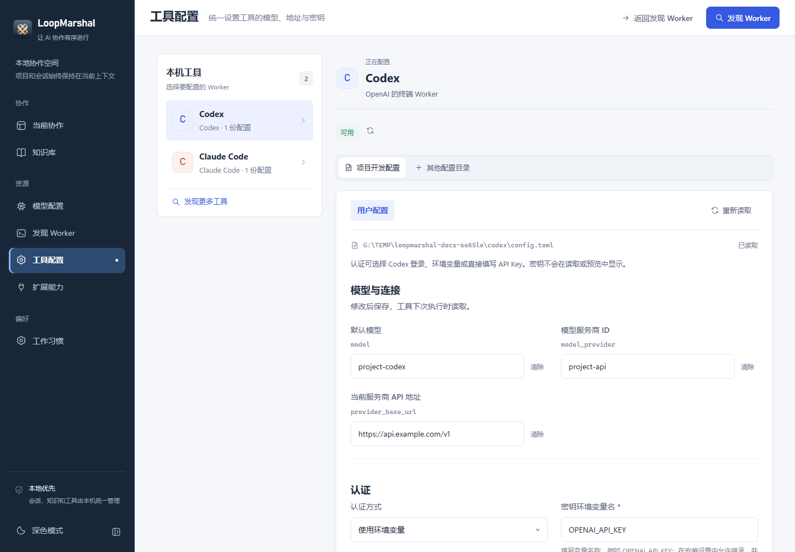
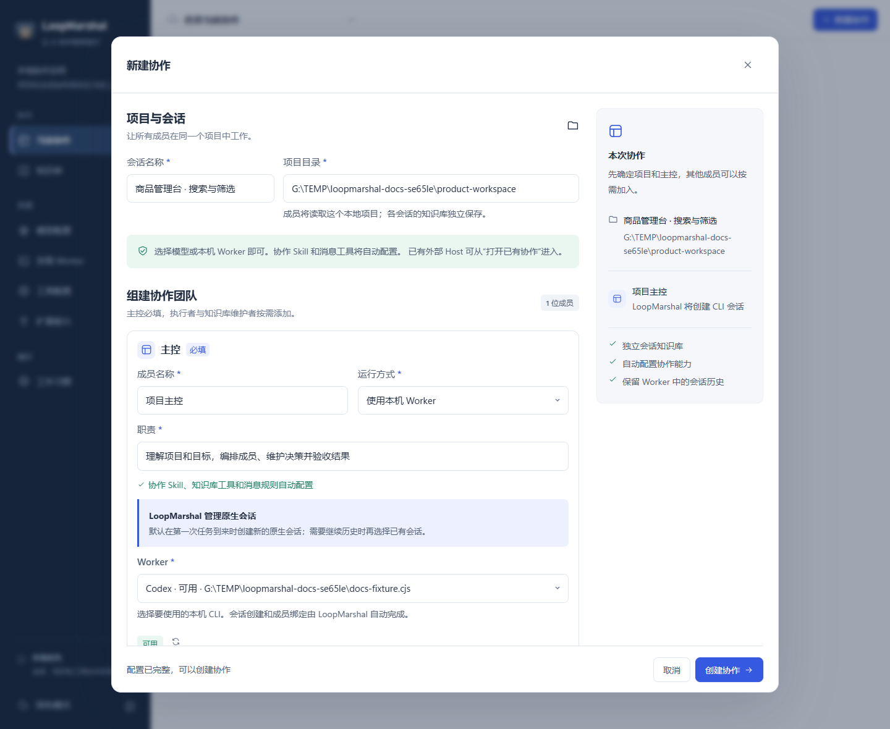
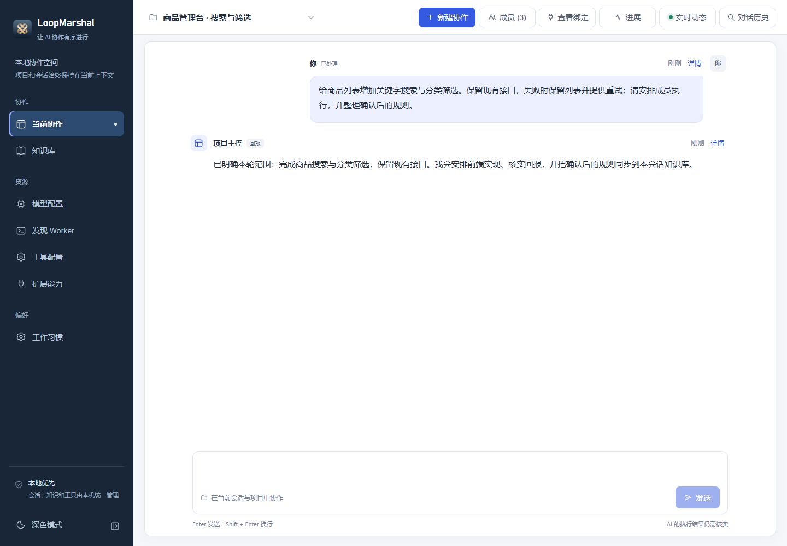
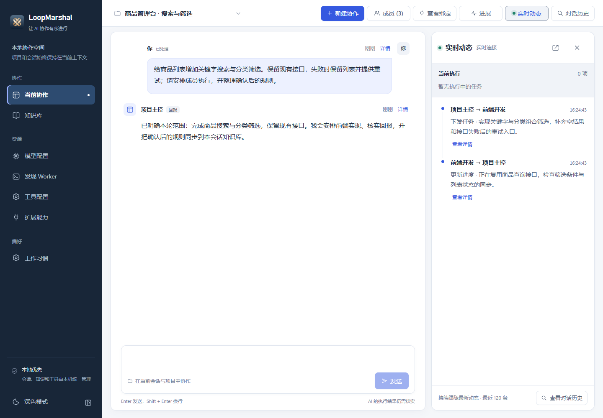
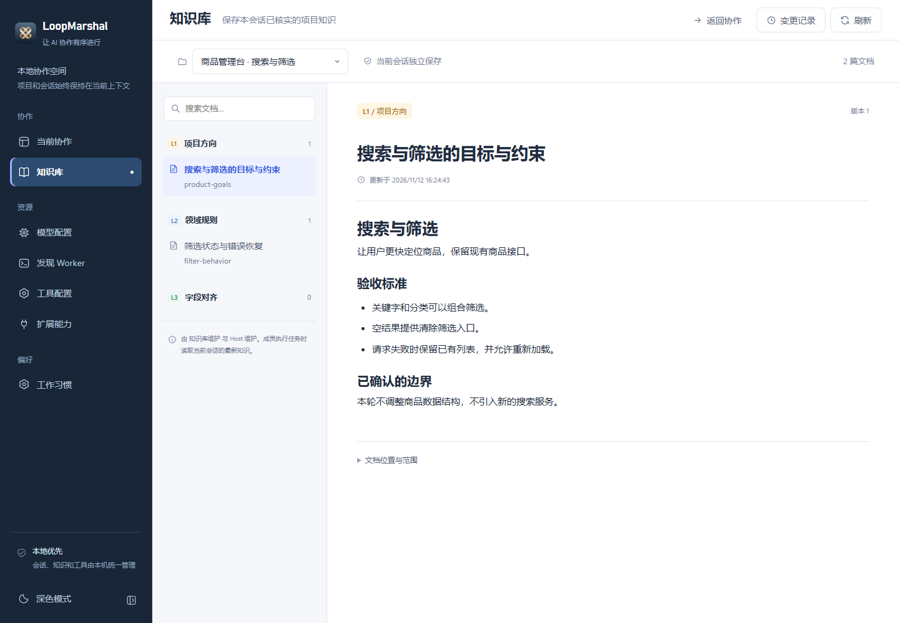

# LoopMarshal

**Bring multiple coding agents together around one project, in one workspace.**

LoopMarshal is a local-first AI coding collaboration tool. You give a Host a goal; it assigns work by member name, reviews reports, and maintains the session's project knowledge. The desktop app, CLI, and MCP integrations share the same Core, member registry, and message records.

[](./LICENSE)
[](./CHANGELOG.md)
[](https://nodejs.org)

**English** | [中文](./README.md)

[Quick start](#quick-start) · [First collaboration guide (Chinese)](./FIRST_COLLABORATION.md) · [Compatibility](./CLI_COMPATIBILITY.md) · [Desktop build](./DESKTOP_BUILD.md)

**0.1.0 Preview** is available as a [Windows x64 installer](https://github.com/Rainbow0328/loopMarshal/releases/tag/v0.1.0) or from source. The installer includes its runtime; third-party tools and model services are configured separately. Detailed guides currently use Chinese; this README covers the main workflow in English, with the actual Chinese UI labels alongside it.

## What it does

- Creates project-based collaborations with one required Host and optional Workers and Knowledge Keeper.
- Routes proxy tasks to a specific tool and native session. It can create a session on the first task or explicitly bind an existing one; subsequent tasks continue that history.
- Combines Core-managed model agents, proxied CLIs, and external IDE/MCP or CLI waiting members in one collaboration.
- Edits supported native model, API URL, and authentication settings from a separate configuration page, with preview, backups, restore, and conflict detection.
- Keeps the main conversation focused on the user and Host. Internal collaboration is available through live activity and searchable history.
- Maintains a separate L1/L2/L3 knowledge base for each collaboration session.

## Quick start

Follow this sequence: **prepare a tool or model → choose a project → configure a Host → add a Worker → create the collaboration → send a goal → inspect the reports**.

| Your starting point                                                | Where to go                                                                          |
| ------------------------------------------------------------------ | ------------------------------------------------------------------------------------ |
| Codex, Claude Code, or another tool already works on your computer | **发现 Worker** to register it, then **工具配置** to check its model and credentials |
| You have a model API endpoint and credentials                      | **模型配置 → 添加模型**; no third-party CLI is needed                                |
| An external agent has already created a LoopMarshal collaboration  | Click the session name → **刷新 / 打开已有协作**                                     |

Already have the app running? Start at step 2. The [detailed first collaboration guide (Chinese)](./FIRST_COLLABORATION.md) explains every field, member setup, and common blocker.

### 1. Open the desktop app or browser workspace

Download the [preview installer](https://github.com/Rainbow0328/loopMarshal/releases/tag/v0.1.0), run `LoopMarshal-Setup-0.1.0-x64.exe`, and open LoopMarshal. The Windows app includes its runtime, so end users do not need Node.js or pnpm. Third-party coding tools still need to be installed and authenticated separately.

To run from source, install **Node.js 22.13+ (24 recommended) and pnpm 10.10.0**:

```powershell
git clone https://github.com/Rainbow0328/loopMarshal.git
cd loopMarshal
pnpm install --frozen-lockfile
pnpm run desktop:dev
```

For the browser workspace instead:

```powershell
pnpm run build
pnpm run start:core
```

Open [http://127.0.0.1:42688](http://127.0.0.1:42688). The desktop app manages its own Core; do not start another server on the same port alongside it. See [desktop build and installation](./DESKTOP_BUILD.md) for packaging.

### 2. Prepare a tool or model connection

**Option A: use an installed coding tool.**

1. Open **发现 Worker** (Discover Worker), click the scan button with the same label, then **添加工具** (Add tool) on the matching result. If discovery misses it, add the actual executable or launcher file manually.
2. Open **工具配置** (Tool configuration), choose the tool, check its real configuration directory, and review its model, Base URL, and authentication settings. Existing working settings can be kept.
3. If you edit settings, click **保存修改 → 确认写入** (Save changes → Confirm write) after reviewing the preview. Codex can use its existing login, a named environment variable, or a directly entered API key. Supported fields vary by tool.

The tool data directory, such as `.codex` or `.claude` under your user directory, stores tool configuration and history. **It is different from the project source directory.** Environment variables must exist in the app/Core startup environment and be explicitly allowed for the tool to inherit. Existing tool processes may need a restart.



**Option B: let LoopMarshal execute a model agent.** Open **模型配置 → 添加模型** (Model configuration → Add model). Enter a display name, select the provider, and enter the provider's actual model ID. Set Base URL for a custom endpoint and provide an API key when required, then click **添加** (Add). A blank key only works when the corresponding startup environment variable is already available.

Choose either option; you do not need both. Model connections do not edit Codex/Claude settings. Saving a connection does not test model access; the first task makes the actual request.

### 3. Create a collaboration with a project and Host

1. Under **当前协作** (Current collaboration), click **新建协作** (New collaboration).
2. Enter **会话名称** (Session name) and an existing **项目目录** (Project directory), for example your real repository at `D:\Projects\shop-admin`. On desktop, **浏览** (Browse) opens the folder picker.
3. In the **主控** (Host) card, enter a member name such as `项目主控` and keep or edit its responsibility. Choose its execution mode and complete the matching settings below.

| Mode                                    | Preparation                                                                                                        |
| --------------------------------------- | ------------------------------------------------------------------------------------------------------------------ |
| 使用本地模型 — use a configured model   | Save a model service connection first. The endpoint may run locally or remotely.                                   |
| 使用本机 Worker — use an installed tool | Choose an installation and its actual data directory. MiMo/OpenCode also require a running native session service. |

A Host is required. Each member needs a unique name and a nonempty responsibility. “使用本地模型” means Core executes the agent; its model endpoint can be local or remote.

**Creating a new CLI session does not require an old session ID.** LoopMarshal creates it on the first task and records the returned ID. An exact ID and project check are needed only when choosing an existing session.



**Add the team before creating:**

1. Scroll down inside the form and click **添加 Worker** (Add Worker). Name it `前端开发` and describe its implementation and reporting responsibilities.
2. Choose its mode and model or tool. New cards default to **使用本地模型**; change this to **使用本机 Worker** to use Codex/Claude, then select the installation and check its data directory.
3. Optionally click **添加知识库维护者** (Add Knowledge Keeper), name it `知识库维护`, and configure it the same way. Without a Keeper, the Host can maintain knowledge itself.
4. When the footer says **配置已完整，可以创建协作**, click **创建协作** (Create collaboration). If disabled, follow **还需完成：…** (Still needed) in the footer and check every added card.

After creation, the app opens the new session. Click **成员** (Members) to verify the Host and Workers. Host-only setup supports discussion; add at least one Worker for delegated work. Core prepares the basic collaboration instructions, tools, and identity automatically; extra MCP tools and Skills are optional. See [member setup with a screenshot (Chinese)](./FIRST_COLLABORATION.md#第三步加入-worker-和知识库维护者).

### 4. Give the Host a goal

To observe the first dispatch, open **实时动态** (Live activity) **before sending**. It shows new events from that point; older events remain in history.

In the main composer, state the task, constraints, acceptance criteria, and actual member names. Adapt this product-list example to your own project:

```text
Read the project and this session's knowledge base first.
Add keyword and category filters to the product list. Keep the current API and data structure.
Assign implementation to “前端开发” and review its report.
If “知识库维护” was added, ask it to verify and document confirmed project rules.
Accept when filters can be combined, empty results can be cleared,
and failed requests preserve existing results and allow retry.
Report changed files, checks actually run, results, and unresolved issues.
```

Click **发送** (Send) or press Enter; Shift+Enter inserts a newline. A proxy Host creates its native session on first execution and continues that history later. A model Host runs through Core.



### 5. Inspect collaboration and knowledge

| Control                  | Purpose                                                                                     |
| ------------------------ | ------------------------------------------------------------------------------------------- |
| 成员 — Members           | Host, Workers, Keeper, external members, responsibilities, and supported runtime operations |
| 查看绑定 — View bindings | Native session routing, connection settings, and delivery records                           |
| 进展 — Progress          | Goals, plans, blockers, and review status recorded by the Host                              |
| 实时动态 — Live activity | New collaboration events since opening; links to conversation history                       |
| 对话历史 — History       | Search recorded messages by member, type, processing status, and content                    |



Open **知识库** (Knowledge base) to browse the current session's goals, domain rules, and field contracts. Switching sessions changes the knowledge scope. Updates refresh in the UI. Runtime counters, member IDs, and test probes do not belong in project knowledge.

Check a full cycle: **Host receives your goal → assigns work to the intended Worker → Worker executes and reports → Host reviews → confirmed lasting facts are documented when needed → you verify the actual code and checks**. A sent message or an available tool does not prove task completion. A new knowledge base can be empty until confirmed facts are written.



These are screenshots of the current browser workspace using an isolated demo project and controlled tool responses. They illustrate the real interface and **are not evidence of autonomous collaboration with real models**. The desktop app uses the same workspace. See [screenshot instructions](./assets/screenshots/README.md) to regenerate them.

### Common first-use blockers

| Symptom                                        | What to do                                                                                                                                                                |
| ---------------------------------------------- | ------------------------------------------------------------------------------------------------------------------------------------------------------------------------- |
| Create is disabled                             | Read **还需完成** in the footer; complete the project and every member's name, responsibility, and model/tool settings, or remove unused optional members                 |
| “选择模型配置” appears when you want Codex     | Switch that member to **使用本机 Worker**, then select the registered Codex installation                                                                                  |
| A new collaboration asks for an old session ID | Change **会话处理方式** back to **新建原生会话（推荐）**                                                                                                                  |
| No response after sending                      | Check **查看绑定 → 投递记录** and **对话历史** for errors; start paused/stopped model agents under **成员**; external waiting agents must connect and consume their inbox |
| Incorrect model, endpoint, or credentials      | Use **工具配置** for installed tools and **模型配置** for Core-managed agents                                                                                             |
| Live activity misses earlier messages          | Open **查看对话历史**; live activity only follows events since it was opened                                                                                              |

See [full troubleshooting (Chinese)](./FIRST_COLLABORATION.md#常见问题). If delivery has an uncertain outcome, check what actually ran before resending to avoid duplicate changes.

### Continue an external Host collaboration

If an IDE/CLI agent created a collaboration through LoopMarshal MCP or CLI, click the current session name and use **刷新** (Refresh) or **打开已有协作** (Open existing collaboration) at the top of the session picker. The external agent must use the same Core. This lists registered collaborations, not every private chat in third-party tools.

## Install a Worker

Open **发现 Worker → 安装 Worker**, choose a tool and a storage root, then install. The official npm packages for Codex, Claude Code, Qwen Code, Gemini CLI, OpenCode and MiMo are supported. Programs, configuration and managed caches use separate folders under your chosen root; existing installations and system PATH are preserved. New Windows desktop builds bundle Node/npm; source users need Node.js 22+ and npm.

Choose an existing model connection during installation, or use **工具配置 → 导入已有模型** afterwards. Review the destination and masked changes before writing; original files are backed up. Codex requires Responses support and explicit confirmation; Claude Code requires Anthropic Messages. Gemini CLI needs native Gemini authentication and cannot use an OpenAI/Anthropic connection directly. MiMo/OpenCode collaboration still requires a running session server. Installation does not validate model access or eliminate every vendor-specific dependency.

For project collaboration with fresh managed profiles, Codex defaults to workspace writes with an unelevated Windows sandbox, and Claude Code uses its native automatic permission review. Explicit policies in existing configuration remain in effect. Workers can find the bundled Node runtime; native permission denials are reported as blocked operations.

## Discuss and reuse conclusions

Open **讨论室**, create a room with 1–8 saved models or supported CLI members, and choose who replies each round. Codex and Claude Code discussion members use isolated native conversations with execution restricted; other tools retain their existing project-collaboration support. Replies appear independently, and a round can be stopped.

Select source messages in **讨论知识库**, generate a draft with a room member, then review and save it. This knowledge belongs to the room, with traceable sources. In a project Host conversation, **引用讨论知识** can insert a saved summary or grant that collaboration permission to retrieve the room's knowledge through `discussion_read`. The Host reads brief summaries first and requests source excerpts only when needed. Room references are not silently promoted to project knowledge. Access can be revoked; previously sent content cannot be recalled.

## Compatibility

There are currently **11 native proxy adapters**. Discovery does not imply every tool version, account, and model has passed full validation.

| Tools                                                            | Validation and main conditions                                                                                                                                                |
| ---------------------------------------------------------------- | ----------------------------------------------------------------------------------------------------------------------------------------------------------------------------- |
| Codex, Claude Code                                               | Real-model collaboration records exist; each tool keeps its own authentication and permissions.                                                                               |
| MiMo Code                                                        | Real collaboration records exist; start the native session service first.                                                                                                     |
| Qwen Code, ZCode, OpenCode                                       | Official programs tested with a deterministic local model service. The tested Qwen version needs explicit `--bare`; OpenCode requires its session service.                    |
| Gemini CLI, Kimi Code CLI 2.x, Factory Droid, GitHub Copilot CLI | Official programs tested with a deterministic local model service; version, permission, and configuration limits apply.                                                       |
| Cursor CLI                                                       | Entry point and arguments checked; real history continuation remains unverified. Only CLI sessions created and recorded by LoopMarshal are supported, not imported IDE chats. |

Tools without a proxy adapter can still join through the existing MCP/CLI waiting workflow. The legacy `start-agent` launch/configuration list is a different capability from native proxy routing. See [the compatibility matrix](./CLI_COMPATIBILITY.md) for versions, conditions, and evidence.

The UI shows availability or a concrete blocker and next steps. Availability covers tool startup and configuration checks; it does not guarantee model authorization, quota, or task success.

## Roles and knowledge

```text
User goal → Host plans → Core routes by session and member name
          → Worker executes and reports → Host reviews
          → Host / Knowledge Keeper updates confirmed knowledge
          → Further work or user acceptance
```

| Role             | Responsibility                                                                              |
| ---------------- | ------------------------------------------------------------------------------------------- |
| Host             | Understand goals, assign work, review results, decide knowledge changes, request acceptance |
| Worker           | Execute tasks and report results, validation, and proposed knowledge changes                |
| Knowledge Keeper | Verify and maintain this session's project knowledge; report to the Host                    |

L1 holds goals and lasting constraints; L2 holds domain rules and module boundaries; L3 holds fields, parameters, and interface contracts. Future decisions read updated knowledge, while its correctness still needs review.

## CLI and MCP

Optionally register the global CLI:

```powershell
pnpm run build
pnpm run link:cli
loopmarshal --version
loopmarshal --help
```

**Application control for external programs:** connect to the same running Core. These commands do not require joining a session:

```powershell
loopmarshal api actions
loopmarshal api describe session.create
loopmarshal model list
loopmarshal tool list
loopmarshal tool discover
loopmarshal tool check <installation-id>
loopmarshal session list
loopmarshal session create --input-file team.json
loopmarshal session get product-ui
loopmarshal session message product-ui --content 'Inspect the project and propose a plan' --idempotency-key request-1
```

`team.json` uses the desktop session setup schema: `sessionName`, `projectPath`, and an `agents` array with exactly one Host. Each agent has `name`, `role`, `duty`, and `mode`. For `core_runtime`, supply `modelConfigId` from `model list`. For `managed_proxy`, supply `binding.installationId`, `binding.workspacePath`, and `binding.runtimeNamespace`; a new native conversation is created on the first task and subsequent messages resume that exact ID. Existing native sessions require `nativeSessionMode: "existing"` and `binding.nativeSessionId`. Workers may also use `mcp_await` or `cli_await`.

Use `api describe <action>` for the exact schema and `api call <action> --input-file request.json` to invoke any listed action. `--input-file -` reads JSON from stdin. Groups cover sessions/members, messages/deliveries/runtimes, models, tool discovery/registration/configuration/installation, session knowledge, discussion rooms, reviewed discussion knowledge, and access grants. New commands return `{"apiVersion":"1","data":...}` or `{"apiVersion":"1","error":...}` with a nonzero exit code. Reuse idempotency keys when retrying message sends; poll recorded messages or execution events for the eventual answer. Model queries mask credentials, and an omitted API key is preserved on update. Native configuration writes retain the existing fingerprint, preview, backup and apply flow.

External MCP clients launch `loopmarshal mcp serve`: call `app_capabilities`, read an action's schema with `app_describe`, then invoke `app_call` with `{ "action": "session.get", "input": { "session": "product-ui" } }`. Common operations also have direct tools: `session_create/list/get/message`, `model_list`, `tool_list/discover/check`, and `discussion_list`. Control connections use local management credentials; applications need not attach as members, and locally authorized Hosts can also use these tools. Worker/Keeper connections and connections holding only `LOOPMARSHAL_MEMBER_TOKEN` retain the collaboration tools and cannot invoke global management actions. The desktop CLI wrapper selects its running backend automatically. Source clients can set `LOOPMARSHAL_BASE_URL` and the backend's `LOOPMARSHAL_DATABASE_PATH` to select the same service and management credential.

In the project directory, the following **member collaboration commands** require an already registered sender:

```powershell
loopmarshal attach host --session product-ui --role host --duty 'Plan, coordinate, and review'
loopmarshal members host --session product-ui
loopmarshal dispatch-many host --session product-ui --task 'frontend::Implement search and filters'
loopmarshal send --session product-ui --from host --to frontend --type task --content '{"content":"Add empty and retry states"}' --idempotency-key search-1
loopmarshal messages host --session product-ui --member frontend --limit 20

# Waiting members only; proxy Workers do not need an await process.
loopmarshal await frontend --session product-ui
loopmarshal submit frontend --session product-ui --content 'Results and verification'
```

The desktop package also includes a CLI entry point without a global install; see [desktop command access](./DESKTOP_BUILD.md#host-的命令入口). MCP and CLI use the same session identity and routing rules. See the [first collaboration guide](./FIRST_COLLABORATION.md#继续已有协作) for joining sessions and native session precautions.

Run `pnpm run smoke:external` for an isolated CLI/MCP integration check with a local deterministic model and native-tool fixture; it does not call paid provider APIs.

## Data and current boundaries

- SQLite stores collaboration records locally; knowledge files are separated by session. Windows uses `%LOCALAPPDATA%\loopmarshal` by default; other platforms use their user data directories.
- Model traffic goes to the configured provider. Third-party tools retain their own data handling. Local-first storage does not imply offline models.
- Missing native history, project mismatches, or uncertain execution results require repair or review rather than silently choosing another session.
- Tasks targeting the same native session run serially. Automatic worktree isolation is not implemented; the Host must coordinate overlapping file edits.
- Observation windows show task activity, not a native terminal. Arbitrary IDE takeover, PTY reattachment, and Host identity transfer are not implemented.
- Native configuration editing covers adapted fields, not every precedence layer or live process update.

## Development

```powershell
pnpm run format
pnpm run lint
pnpm run test
pnpm run build
```

Build through pnpm so injected workspace dependencies receive new output. The [contribution guide](./CONTRIBUTING.md#coding-and-performance) explains module boundaries, shared connections, coalesced refreshes, lazy routes, and batched message rendering. The message API still reads full history; bounded UI rendering is not server-side pagination.

```text
apps/desktop/        Windows shell and managed Core lifecycle
apps/web/            React workspace, split by feature
apps/core/           HTTP / WebSocket / MCP and collaboration services
apps/cli/            Commands, identity, tool integration, and waiting workflow
packages/protocol/   Shared types and validation
packages/store/      SQLite, transactions, and repositories
packages/sdk/        HTTP / WebSocket clients
packages/shared/     Shared configuration and utilities
skills/              Role instructions for external tools
scripts/             Builds, regressions, and documentation screenshots
```

See [contributing](./CONTRIBUTING.md) and the [changelog](./CHANGELOG.md).

## License

[Apache License 2.0](./LICENSE)
