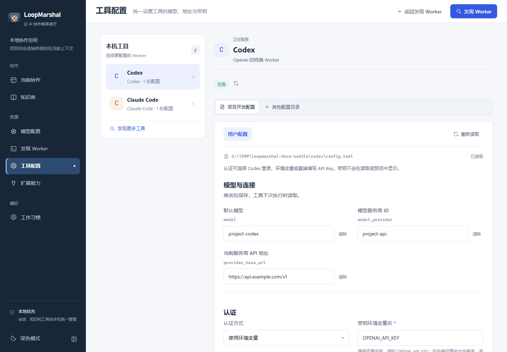
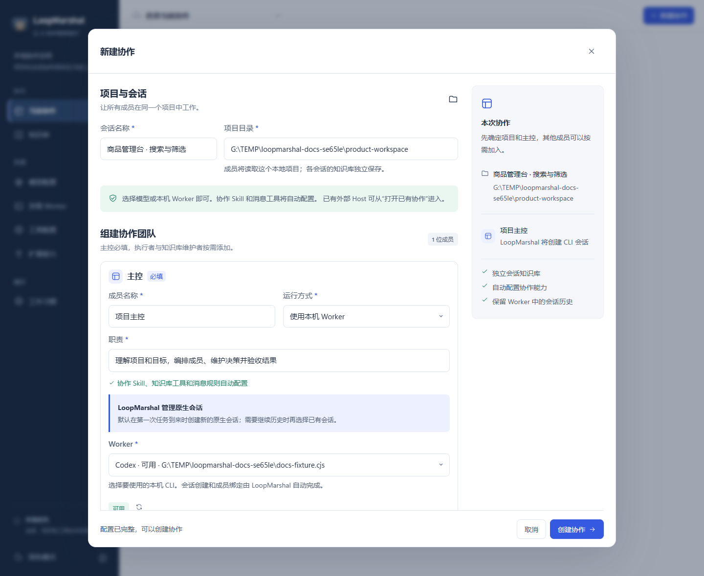
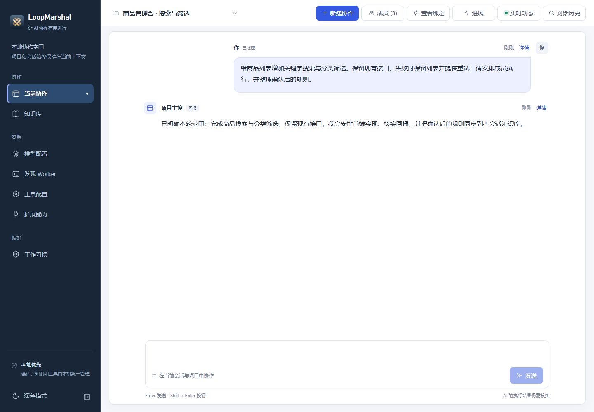
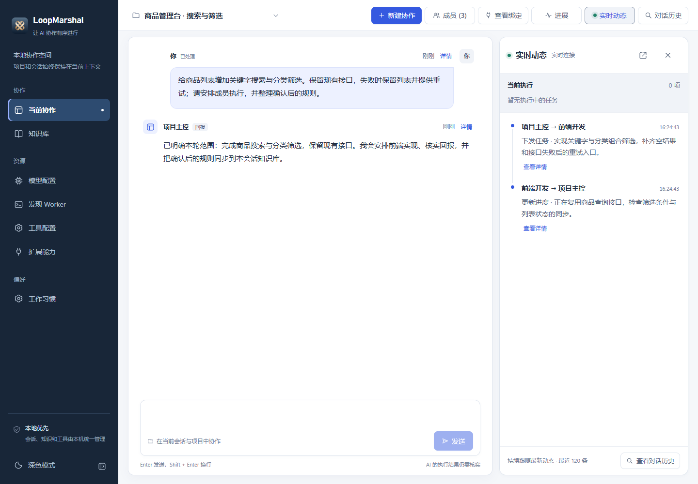
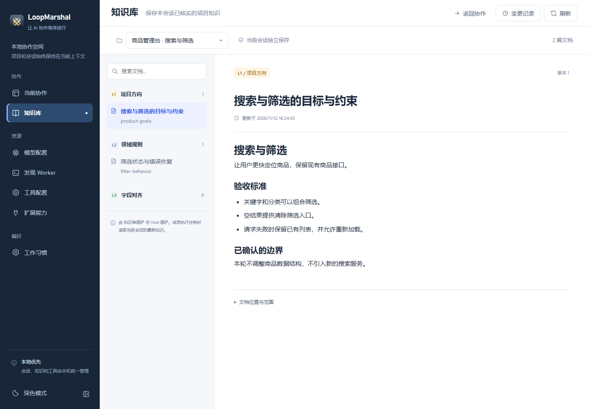

# LoopMarshal

**在一个窗口里，让多个 AI 围绕同一个项目协作。**

LoopMarshal 是本地优先的 AI 编程协作工具：你向 Host 提出目标，Host 按成员名称安排 Worker 执行、核实回报，并维护当前会话的项目知识。桌面客户端、命令行和 MCP 共用同一个 Core、成员登记和消息记录。

[](./LICENSE)
[](./CHANGELOG.md)
[](https://nodejs.org)

**中文** | [English](./README-EN.md)

[快速开始](#快速开始) · [首次协作完整教程](./FIRST_COLLABORATION.md) · [兼容范围](./CLI_COMPATIBILITY.md) · [桌面构建](./DESKTOP_BUILD.md) · [文档导航](./DOCUMENTATION.md)

当前版本为 **0.1.0 Preview（预览版）**。[下载 Windows x64 安装包](https://github.com/Rainbow0328/loopMarshal/releases/tag/v0.1.0)，或从下方源码运行。安装包包含运行时，无需另装 Node.js；第三方工具和模型服务需自行准备。

## 能做什么

- **围绕项目创建协作**：指定项目目录，配置唯一 Host，按需加入 Worker 和知识库维护者。
- **精准续接工具会话**：代理成员集中记录工具、项目、数据目录和原生会话 ID；新建时自动创建，后续任务接续同一份历史，也可明确绑定已有会话。
- **兼容不同接入方式**：本地模型 Agent、代理 CLI、外部 IDE/MCP 和 CLI 等待式成员可以在同一协作会话中工作。
- **统一管理工具配置**：在独立页面修改已适配的模型、API 地址和密钥，预览后写回原工具配置，支持备份、恢复和修改冲突检查。
- **保持清楚的对话空间**：主界面只展示用户与 Host 的对话；成员协作在“实时动态”中查看，完整记录可检索。
- **按会话维护知识**：L1 项目方向、L2 领域规则、L3 字段与接口契约互相隔离，由 Host 或知识库维护者核实更新。

## 快速开始

第一次使用，按这个顺序操作即可：**准备工具或模型 → 新建协作并选项目 → 配置 Host → 添加 Worker → 创建协作 → 给 Host 发任务 → 检查回报**。

| 你想做什么                              | 直接去哪里                                                 |
| --------------------------------------- | ---------------------------------------------------------- |
| 用已经装好的 Codex、Claude Code 等协作  | **发现 Worker** 登记工具，再到 **工具配置** 核对模型与账号 |
| 只用模型 API，由 LoopMarshal 执行 Agent | **模型配置 → 添加模型**，不用先安装第三方 CLI              |
| 继续外部 Agent 已创建的协作             | 左上角会话名称 → **刷新 / 打开已有协作**                   |

已有客户端可直接从第 2 步开始；想逐项了解字段、添加成员或处理报错，见 [首次协作完整教程](./FIRST_COLLABORATION.md)。

### 1. 启动客户端或浏览器工作台

在[预览版下载页](https://github.com/Rainbow0328/loopMarshal/releases/tag/v0.1.0)下载并运行 `LoopMarshal-Setup-0.1.0-x64.exe`，安装后打开 LoopMarshal。Windows 客户端自带运行时，使用者无需另外安装 Node.js 或 pnpm；要代理的第三方编程工具仍需自行安装并完成认证。

从源码运行需要 **Node.js 22.13+（推荐 24）和 pnpm 10.10.0**：

```powershell
git clone --branch feat/desktop-loop-marshal https://github.com/Rainbow0328/loopMarshal.git
cd loopMarshal
pnpm install --frozen-lockfile
pnpm run desktop:dev
```

也可以使用浏览器工作台：

```powershell
pnpm run build
pnpm run start:core
```

打开 [http://127.0.0.1:42688](http://127.0.0.1:42688)。桌面客户端自行管理 Core，使用桌面版时不要另外启动占用相同端口的服务。完整打包方法见 [桌面构建](./DESKTOP_BUILD.md)。

### 2. 准备工具或模型

**方式 A：使用本机 Codex、Claude Code 等工具。**

1. 进入左侧 **发现 Worker**，点击页面中的 **发现 Worker** 扫描，再点击找到项的 **添加工具**；没找到时手动添加工具的可执行文件。
2. 进入左侧 **工具配置**，选择该工具，确认实际配置目录，核对模型、Base URL 和认证信息。已有正确配置可直接沿用。
3. 需要修改时，点 **保存修改 → 确认写入**。Codex 支持沿用官方登录、环境变量或直接填写 API Key；其他工具按页面支持的字段设置。

工具数据目录是 `.codex`、`.claude` 等保存配置与历史的目录，**不是要开发的项目目录**。使用环境变量时，变量值须在客户端/Core 的启动环境中，并允许该工具继承；已有进程是否需要重启取决于原工具。详细说明见 [准备本机工具](./FIRST_COLLABORATION.md#方式-a使用本机-codexclaude-code-等工具)。



**方式 B：由 LoopMarshal 执行模型 Agent。**进入 **模型配置 → 添加模型**，填写显示名称，选择提供商，填写服务商的实际模型 ID；自定义服务填写 Base URL，按服务要求填写 API Key，再点 **添加**。留空密钥只适用于启动环境已有相应变量的情况。保存不等于调用验证，首条任务会实际调用服务。

以上两种方式选一种即可。“模型配置”供内置 Agent 使用，“工具配置”修改第三方工具自己的文件。不要为了使用 Codex 再重复配置一份内置模型。

### 3. 新建协作，指定项目和 Host

1. 在 **当前协作** 点击 **新建协作**。
2. 填写 **会话名称**，例如 `商品管理台`；选择已存在的 **项目目录**，例如 `D:\Projects\shop-admin`。请替换成自己的真实路径；桌面端可点击 **浏览**。
3. 在 **主控** 卡片填写成员名称，例如 `项目主控`；职责可保留默认值，再选择运行方式并补齐下面的设置。

| 选择            | 需要准备                                                                     |
| --------------- | ---------------------------------------------------------------------------- |
| 使用本地模型    | 在“模型配置”中保存一个可用的服务连接；服务可以是本机或远程模型接口           |
| 使用本机 Worker | 选择已登记的工具及其真实数据目录；MiMo/OpenCode 还需提供已启动的会话服务地址 |

**Host 必填。**名称和职责也必填；同一团队的成员名称不能重复。“使用本地模型”表示由 LoopMarshal 执行 Agent，模型接口可以在本机或远程。

**新建 CLI 会话无需填写已有会话 ID**：第一条任务到来时，LoopMarshal 创建原生会话并记录实际编号。只有选择接入已有会话时，才需要准确 ID，并核验项目归属。



**加入执行者，再创建团队：**

1. 在表单中向下滚动，点击 **添加 Worker**，把新执行者名称设为 `前端开发`，填写其职责。
2. 为它选择运行方式和对应模型或工具。新卡片默认“使用本地模型”；想使用 Codex/Claude 时，改成 **使用本机 Worker**，再选择工具并核对数据目录。
3. 需要专人整理知识时，点击 **添加知识库维护者**，例如取名 `知识库维护`，同样配好执行方式。不添加时 Host 也可以维护知识。
4. 底部显示 **配置已完整，可以创建协作** 后点击 **创建协作**。若按钮灰色，按 **还需完成：……** 补齐，尤其检查后来添加的成员。

创建成功后会进入新会话，点击 **成员** 核对 Host 和 Worker 是否齐全。只配置 Host 也能开始对话；要多人执行，请至少添加一位 Worker。基础协作 Skill、消息工具和身份自动配置，额外 MCP/Skill 可以不填。更多字段说明与配图见 [添加团队成员](./FIRST_COLLABORATION.md#第三步加入-worker-和知识库维护者)。

### 4. 给 Host 一个目标

想看到第一轮协作过程，先点顶部 **实时动态**，再在主聊天输入框发送任务。它只展示打开后的新事件，之前的内容在“对话历史”查看。

用实际成员名称说明谁做什么，例如以下任务适用于商品管理类项目：

```text
请先阅读当前项目和本会话知识库，给商品列表增加关键字搜索与分类筛选。
保留现有接口，不改商品数据结构。
请把实现交给“前端开发”，由你核实回报；若已添加“知识库维护”，请它整理确认后的规则。
验收：搜索与分类可组合，空结果可清除筛选，失败时保留已有列表并可重试。
完成后回报修改文件、实际执行的检查、结果和遗留问题。
```

点击 **发送**，或按 Enter；Shift+Enter 换行。代理 Host 首次执行会创建原生会话，后续消息续接同一历史；内置模型 Host 由 Core 执行。



### 5. 查看协作过程与知识

顶部操作各有用途：

| 入口     | 查看什么                                                 |
| -------- | -------------------------------------------------------- |
| 成员     | Host、Worker、维护者和外部成员的职责、接入方式及运行操作 |
| 查看绑定 | 工具与原生会话关系、接入调整及投递记录                   |
| 进展     | Host 记录的目标、计划、阻塞和验收状态                    |
| 实时动态 | 打开之后出现的新协作事件；可跳到对话历史                 |
| 对话历史 | 按成员、消息类型、处理状态和关键词检索完整协作记录       |



进入左侧 **知识库**，查看当前会话的项目方向、领域规则与字段契约。切换会话后知识范围随之切换，文档更新后会刷新；成员 ID、运行轮数和测试探针不应写成项目知识。

第一次验收可按顺序确认：**Host 收到目标 → 向指定 Worker 派发 → Worker 执行并回报 → Host 核实结果 → 有新事实时更新知识 → 你检查真实代码与验证记录**。消息发出或工具显示可用，不等于开发任务完成。新建后知识库为空也正常，确认事实并写入后才有文档。



截图来自当前代码运行的浏览器工作台，使用独立演示项目与受控工具响应；它们用于说明实际界面，**不作为真实模型自主协作的验收证据**。桌面版复用同一套工作台。截图生成方式见 [截图说明](./assets/screenshots/README.md)。

### 遇到问题时先看这里

| 问题                             | 处理方式                                                                                                       |
| -------------------------------- | -------------------------------------------------------------------------------------------------------------- |
| 创建按钮点不动                   | 看底部“还需完成”，补齐项目及每位成员的名称、职责、模型或工具；暂时不用的成员可移除                             |
| 想用 Codex，却提示“选择模型配置” | 把对应成员的运行方式改为“使用本机 Worker”，再选择 Codex                                                        |
| 新建时被要求填旧会话编号         | 将“会话处理方式”改回“新建原生会话（推荐）”                                                                     |
| 发出任务后没有回应               | 看“查看绑定 → 投递记录”及“对话历史”的错误；模型成员如已暂停/停止，在“成员”中启动；外部等待成员需真正连接并领取 |
| API Key、地址或模型有误          | 本机工具到“工具配置”修改，内置 Agent 到“模型配置”核对                                                          |
| 实时动态没有旧消息               | 点击“查看对话历史”；实时动态只看打开后的事件                                                                   |

更多排查见 [首次协作常见问题](./FIRST_COLLABORATION.md#常见问题)。投递结果待核对时先确认实际执行情况，避免盲目重发重复修改。

### 继续外部工具中的协作

如果 IDE/CLI Agent 已通过 LoopMarshal 的 MCP 或 CLI 创建协作并担任 Host，点击左上角会话名称，在会话列表顶部选择 **刷新** 或 **打开已有协作**。外部工具必须连接同一个 Core；这里读取的是已登记的协作会话，不是任意第三方工具的全部私有聊天。

## 兼容范围

当前有 **11 种原生工具代理适配**，发现工具不等于所有版本、模型和账号均已验收：

| 工具                                                             | 当前验证范围与主要条件                                                                   |
| ---------------------------------------------------------------- | ---------------------------------------------------------------------------------------- |
| Codex、Claude Code                                               | 已有真实模型协作记录；沿用各自认证和权限                                                 |
| MiMo Code                                                        | 已有真实协作记录；需先启动厂商会话服务                                                   |
| Qwen Code、ZCode、OpenCode                                       | 官方程序与本地确定性模型服务验证；Qwen 已验证版本需显式 `--bare`，OpenCode 需会话服务    |
| Gemini CLI、Kimi Code CLI 2.x、Factory Droid、GitHub Copilot CLI | 官方程序与本地确定性模型服务验证；版本、权限和配置边界见兼容表                           |
| Cursor CLI                                                       | 已验证入口及参数；真实历史续接待验收，仅支持本产品创建并记录的 CLI 会话，不导入 IDE 聊天 |

不具备代理适配的工具仍可通过已有 MCP/CLI 等待链加入。旧的 `start-agent` 启动/配置支持列表与原生代理列表不是同一个范围。详细版本、限制和证据见 [Worker 兼容范围](./CLI_COMPATIBILITY.md)。

界面只显示“可用”或具体不可用原因及处理办法；“可用”表示工具启动与配置等检查通过，不保证模型调用必然成功。模型权限、额度和任务结果仍由实际执行核实。

## 协作与知识如何组织

```text
用户给出目标
    → Host 理解项目、明确计划和验收条件
    → Core 按“协作会话 + 成员名称”路由任务
    → Worker 执行并回报，Host 核实结果
    → Host / 知识库维护者更新已确认的项目知识
    → 继续派发，或邀请用户验收
```

| 角色         | 职责                                                   |
| ------------ | ------------------------------------------------------ |
| Host         | 理解目标、安排成员、检查回报、裁决知识及请求用户验收   |
| Worker       | 完成指定任务，提交结果、验证记录及知识变更建议         |
| 知识库维护者 | 核实并维护当前会话知识，向 Host 回报；不替代 Host 编排 |

L1 记录项目目标和长期约束；L2 记录领域规则与模块边界；L3 记录字段、参数和接口契约。更新后，后续决策重新读取当前知识；知识内容是否充分正确仍需核实。

## 命令行与 MCP

可选安装全局命令：

```powershell
pnpm run build
pnpm run link:cli
loopmarshal --version
loopmarshal --help
```

在项目目录连接同一 Core 后，常用命令如下；发送者必须已登记为当前会话成员：

```powershell
# 外部 Host 登记会话，并关联当前项目目录
loopmarshal attach 主控 --session 商品管理台 --role host --duty '理解需求、编排和验收'

# 查看成员、派发任务
loopmarshal members 主控 --session 商品管理台
loopmarshal dispatch-many 主控 --session 商品管理台 --task '前端开发::实现搜索与筛选'

# 按名称路由；相同操作重试时复用幂等键
loopmarshal send --session 商品管理台 --from 主控 --to 前端开发 --type task --content '{"content":"补齐空结果与重试入口"}' --idempotency-key search-1

# Host 只读查询成员消息，不领取或消费任务
loopmarshal messages 主控 --session 商品管理台 --member 前端开发 --limit 20

# 等待式 Worker 沿用原协议，代理 Worker 不需要运行 await
loopmarshal await 前端开发 --session 商品管理台
loopmarshal submit 前端开发 --session 商品管理台 --content '结果与验证记录'
```

桌面安装包另提供随包命令入口，无需全局安装，路径见 [Host 的命令入口](./DESKTOP_BUILD.md#host-的命令入口)。MCP 与 CLI 共用会话、身份和路由规则，详细接入见 [会话与成员](./SESSION_WORKSPACE.md) 和 [原生会话代理](./NATIVE_SESSION_PROXY.md)。

## 数据与运行边界

- 会话、消息、成员关系和投递记录存于本地 SQLite；知识按会话保存在文件中。Windows 默认数据目录为 `%LOCALAPPDATA%\loopmarshal`，其他平台遵循用户数据目录。
- 模型请求仍会发往用户配置的服务商，第三方工具也遵循自身的数据处理方式；“本地优先”不代表所有模型都离线运行。
- 代理始终按已绑定的 ID 续接。历史缺失、项目不符或结果不确定时会阻塞或要求核对，不静默改用最近会话。
- 同一原生会话串行执行。不同成员可能修改同一项目，当前未提供自动 worktree 隔离，需要 Host 分配好修改范围。
- 运行观察展示已有任务事件，不是原生终端；当前不支持任意 IDE 窗口接管、PTY 重新附着或 Host 身份移交。
- 统一配置页只编辑已适配字段；外部进程可能需重启，复杂配置优先级和未适配文件仍由原工具管理。

## 开发与验证

```powershell
pnpm run format       # 统一源码和配置格式
pnpm run lint         # 格式与工作区类型检查
pnpm run test         # 单元与生命周期回归
pnpm run build        # 按依赖顺序构建并同步工作区包
```

构建使用 pnpm 递归生命周期，确保注入式工作区依赖同步。结构拆分、连接复用、刷新合并、按需加载和消息分批展示约定见 [贡献指南](./CONTRIBUTING.md#coding-and-performance)。消息接口目前仍读取完整历史，界面分批展示不等于服务端分页。

```text
apps/desktop/        Windows 桌面窗口与后台生命周期
apps/web/            React 工作台，按功能拆分页面和组件
apps/core/           HTTP / WebSocket / MCP 与协作服务
apps/cli/            命令入口、身份、工具接入与等待流程
packages/protocol/   跨端类型与校验
packages/store/      SQLite、事务与查询
packages/sdk/        HTTP / WebSocket 客户端
packages/shared/     共享配置与基础能力
skills/              外部工具角色指令与配置支持
scripts/             构建、回归与文档截图
```

文档入口、当前使用说明与历史验收记录见 [文档导航](./DOCUMENTATION.md)。参与开发见 [贡献指南](./CONTRIBUTING.md)，开发变化见 [CHANGELOG](./CHANGELOG.md)。

## License

[Apache License 2.0](./LICENSE)
